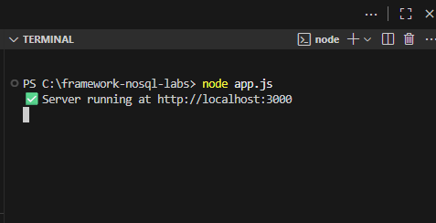
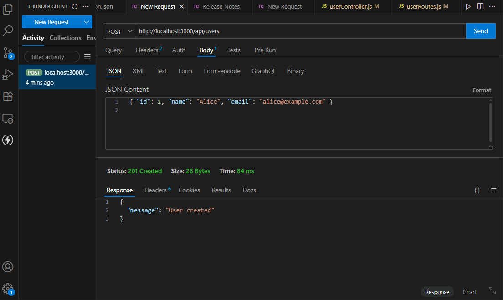
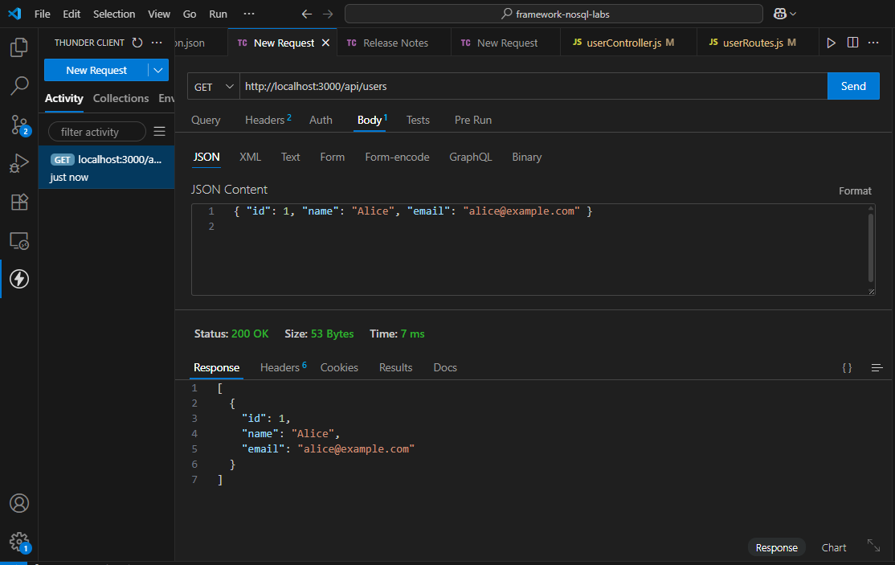
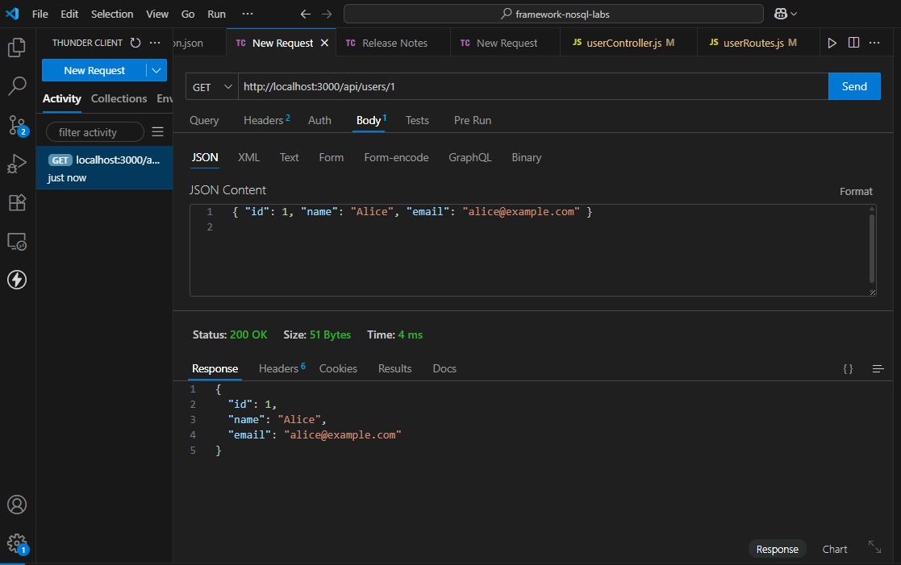
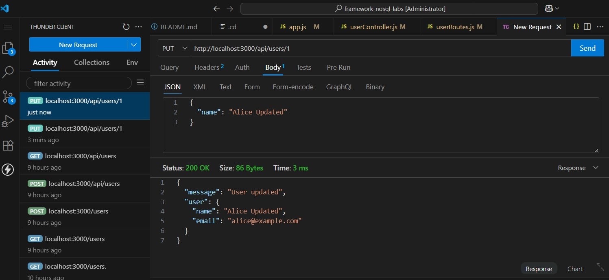
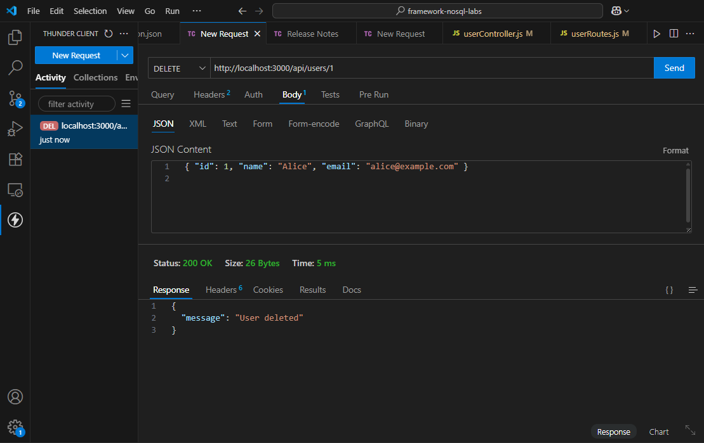
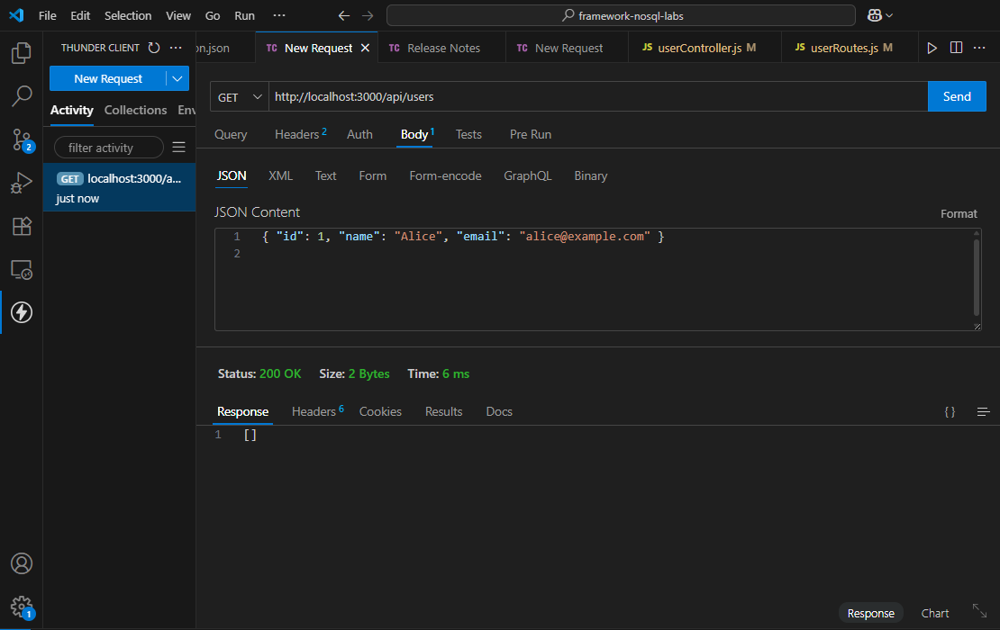

<<<<<<< HEAD
# Framework and NoSQL Technologies - Laboratory Repository

**Student Name:** MARK JHON GUILLERMO  

**Course & Section:** BSIS 3A  

**Professor:** Red Guillermo Jr. V.  

**Email:** mjmg2023-8189-45492@bicol-u.edu.ph  

---

## Repository Purpose
This repository contains all laboratory outputs from Week 1 to Week 9, progressively building toward a full-stack midterm project.

---

## Lab Timeline
| Week | Description |
|------|-------------|
| 1    | Environment Setup & GitHub Integration |
| 2–7  | Backend, Frontend, and NoSQL Development |
| 8    | Project Polish & Local Output |
| 9    | Deployment to Render & Atlas |

---
## Week 3 – Users API (CRUD + Error Handling)

### Endpoints

- **Create User**  
  `POST /api/users`  
  Body: `{ "id": 1, "name": "Alice", "email": "alice@example.com" }`  
  Status: `201 Created` | Errors: `400 Bad Request`, `409 Conflict`

- **Get All Users**  
  `GET /api/users`  
  Status: `200 OK`

- **Get Single User**  
  `GET /api/users/:id`  
  Status: `200 OK` | Errors: `404 Not Found`

- **Update User**  
  `PUT /api/users/:id`  
  Body: `{ "name": "Alice Updated" }`  
  Status: `200 OK` | Errors: `400 Bad Request`, `404 Not Found`

- **Delete User**  
  `DELETE /api/users/:id`  
  Status: `200 OK` | Errors: `404 Not Found`
## Thunder Client Testing (Screenshots)

### 1. Start Server

### 2. Create User (POST)

### 3. Get All Users (GET)

### 4. Get Single User (GET by ID)

### 5. Update User (PUT)

### 6. Delete User (DELETE)

### 7. Get Users (Empty Response)

# Week 4 – MongoDB Atlas & CRUD Testing

This week integrates *MongoDB Atlas* with the Users API.
The database connection is moved from *local memory* to *MongoDB Atlas*, ensuring data persistence.

---

## MongoDB Atlas Setup Steps

1. Create a free cluster on *MongoDB Atlas*.
2. Whitelist your IP address in *Network Access*.
3. Create a database user (username & password).
4. Copy the connection string and update .env:

MONGO_URI=mongodb+srv://<username>:<password>@cluster0.mongodb.net/mydb

---

## CRUD Endpoints with MongoDB Atlas

| *Operation*  | *Method & Endpoint*   | *Request Body (JSON)*                                              | *Response Example*                                                        |
| -------------- | ----------------------- | -------------------------------------------------------------------- | --------------------------------------------------------------------------- |
| Create User    | POST /api/users       | json {"name":"Guillermo","email":"guillermo@example.com"}           | { "_id": "...", "name": "Guillermo", "email": "guillermo@example.com", "__v": 0 } |
| Get All Users  | GET /api/users        | –                                                                    | Array of users                                                              |
| Get User by ID | GET /api/users/:id    | –                                                                    | Single user object                                                          |
| Update User    | PUT /api/users/:id    | json {"name":"Guillermo Updated","email":"guillermo.updated@example.com"} | Updated user object                                                         |
| Delete User    | DELETE /api/users/:id | –                                                                    | Deleted user confirmation                                                   |

---

## Sample JSON Response with MongoDB _id

{
  "_id": "68b5be9be4df145765655c07",
  "name": "Guillermo Updated",
  "email": "guillermo.updated@example.com",
  "__v": 0
}

---

## Thunder Client Tests (Week 4)

| *Test*           | *Screenshot*                          |
| ---------------- | ------------------------------------- |
| POST Create User |        |
| PUT Update User  |          |
| DELETE User      |    |
| GET All Users    |          |
| GET User by ID 2 | .png)   |
